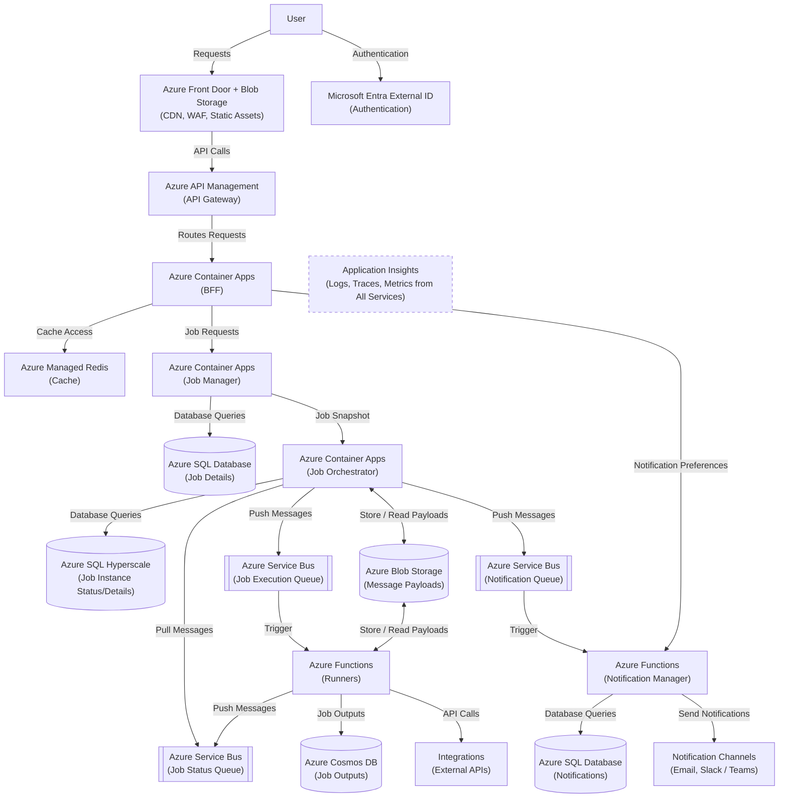

# Home Task Solution: Solution Design and Scalability Analysis

**Cloud provider:** Microsoft Azure

## 1. Infrastructure Diagram

---

## 2. Communication Patterns Between Components

- **User to Front Door:** The browser loads the SPA over HTTPS. Front Door serves static files from Blob Storage out of its edge cache and passes API calls through the WAF to API Management.
- **User to Entra External ID:** The SPA signs the user in with OpenID Connect and attaches the JWT access token to every API call.
- **API Management to BFF:** API Management checks the JWT, enforces rate limits and forwards the REST request to the BFF over the private network.
- **BFF to Redis:** Cache-aside. The BFF checks Redis first; on a miss it calls the owning service and caches the result with a short TTL.
- **BFF to Job Manager and Notification Manager:** Synchronous REST over the private network, for job management and notification preferences respectively.
- **Job Manager to Job Orchestrator:** Synchronous REST call carrying the Job Snapshot. Job Manager writes the job and an outbox record in one transaction and retries from the outbox until the call succeeds; the endpoint is idempotent, so retries are safe. Job status and execution history for the BFF are also read from the Orchestrator through Job Manager.
- **Job Orchestrator to Runners (Job Execution Queue):** For each run the Orchestrator publishes a Service Bus message scheduled for the start time. It triggers a Runner (push), usually within seconds of the start time. Publishing goes through an outbox, and consumers are idempotent because Service Bus can deliver a message more than once.
- **Recurring Jobs and Test Runs:** Only the next occurrence of a recurring job is scheduled at any time. Test runs are published without a delay. When a job is edited or deleted, messages that are already scheduled are cancelled or ignored based on the schedule version.
- **Runners to Job Orchestrator (Job Status Queue):** Runners publish status events. The Orchestrator reads them (pull), updates the run status and releases singleton jobs. A run that reports no status before its deadline is marked as timed out.
- **Job Orchestrator to Notification Manager (Notification Queue):** When a run fails, the Orchestrator publishes a notification event that triggers the Notification Manager (push).
- **Message Payloads (claim-check):** Large content such as the Job Snapshot, job parameters or error details goes to Blob Storage, and the queue message carries only a reference to it. Small messages keep queue throughput high.
- **Services to Databases:** Each service reads and writes only its own database: Job Manager uses Azure SQL (Job Details), the Orchestrator uses Azure SQL Hyperscale (Job Instance Status), the Notification Manager uses Azure SQL (Notifications) and Runners use Cosmos DB (Job Outputs).
- **Runners to Integrations:** HTTPS calls to external APIs with timeouts and retries.
- **Notification Manager to Notification Channels:** HTTPS calls to the email service and to Slack/Teams webhooks, retried on failure.
- **All Services to Application Insights:** Logs, traces and metrics are exported with OpenTelemetry. Trace context travels in HTTP headers and message properties, so a single trace follows a run from the API call to the Runner.
- **Security:** TLS everywhere. Backend Azure services are reached through private endpoints using managed identities, and all data stores encrypt data at rest.

---

## 3. Reasoning for Selection

- **Front Door + Blob Storage:** One global entry point that provides CDN, WAF and DDoS protection. Blob Storage is the simplest and cheapest place to host the SPA's static files.
- **Entra External ID:** Managed customer identity with OpenID Connect and MFA. Our services never store or hash user passwords.
- **API Management:** Gives us JWT validation, rate limits, quotas and API versioning without building them ourselves, and shields the backend from misuse and overload.
- **Container Apps (BFF, Job Manager, Job Orchestrator):** These services run continuously and are latency-sensitive. Minimum replicas avoid cold starts, HTTP-based autoscaling handles load, and we keep full control over background work such as the Orchestrator's scheduling loop, without running a Kubernetes cluster ourselves.
- **Azure Functions (Runners, Notification Manager):** Both workloads are short, bursty and queue-triggered. Functions provide the Service Bus trigger, scale out quickly and charge per execution; always-ready instances remove cold starts where start time matters.
- **Azure Managed Redis:** Job lists and statuses are read far more often than they change. Caching them in the BFF takes that read load off the backend services and their databases.
- **Service Bus:** Has what a scheduler needs: scheduled delivery for start times, duplicate detection and dead-letter queues.
- **Azure SQL Database (Job Details, Notifications):** Relational data with transactions and constraints at moderate volume. The serverless tier keeps the mostly idle Notifications database cheap.
- **Azure SQL Hyperscale (Job Instance Status/Details):** "Due jobs" queries and atomic updates for running singleton jobs are straightforward in SQL, and storage grows automatically as execution history builds up.
- **Cosmos DB (Job Outputs):** Scales out to absorb write bursts from many parallel runs, reads outputs per execution quickly and removes old data through TTL.
- **Blob Storage (Message Payloads):** The cheapest store for large payloads that are written once and read once, which keeps Service Bus messages small.
- **Application Insights:** Supports OpenTelemetry for logs, traces and metrics, and can follow a request across HTTP calls and Service Bus messages.

---

## 4. Scalability Options

- **Front Door + Blob Storage:**
  - Front Door runs on Microsoft's global edge network and scales automatically. Edge caching keeps static traffic off the origin.
  - Blob Storage scales automatically, with no capacity planning needed.
- **Entra External ID:**
  - Managed service that scales with the number of sign-ins.
- **API Management:**
  - Scale out by adding units, manually or with autoscale rules.
  - Rate limits and quotas protect the backend during traffic spikes.
- **Container Apps (BFF, Job Manager):**
  - Stateless, so they scale horizontally on concurrent HTTP requests.
  - Minimum replicas are spread across availability zones.
- **Container Apps (Job Orchestrator):**
  - Job Status Queue consumers scale out as competing consumers.
  - The scheduling loop runs on a single leader elected with a Blob Storage lease. If one leader is not enough, the schedule can be sharded by job ID with one leader per shard.
- **Azure Functions (Runners):**
  - Scale out automatically with the length of the Job Execution Queue.
  - Always-ready instances keep a warm pool for on-time starts.
  - Heavy job types can get their own queue and function app and scale separately.
- **Azure Functions (Notification Manager):**
  - Scales with the Notification Queue and down to zero when idle.
  - A maximum instance count protects its database and keeps it within the channels' rate limits.
- **Azure Managed Redis:**
  - Scale up to a larger size for more memory, vCPUs and shards; clustering is built in.
- **Service Bus:**
  - The Premium tier scales by adding messaging units, manually or with autoscale.
  - Separate queues stop execution, status and notification traffic from affecting each other.
- **Azure SQL Database (Job Details, Notifications):**
  - Scale up by adding vCores; the serverless tier adjusts compute within a configured range.
  - If reads grow, move to Business Critical for a readable replica or add a readable geo-replica.
- **Azure SQL Hyperscale (Job Instance Status/Details):**
  - Storage grows automatically up to 128 TB, and compute can be scaled quickly regardless of database size.
  - Read replicas take history queries off the primary. Old execution history is partitioned by date and archived.
- **Cosmos DB (Job Outputs):**
  - Autoscale throughput follows write bursts.
  - Partitioning by execution ID spreads data and load evenly; TTL stops storage from growing indefinitely.
- **Blob Storage (Message Payloads):**
  - Scales automatically. Lifecycle rules delete payloads after a retention period long enough for retries and dead-letter recovery.
- **Application Insights:**
  - Scales with telemetry volume. Sampling controls ingestion and cost; execution logs are excluded from it.
