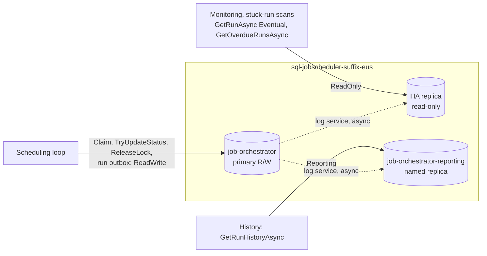
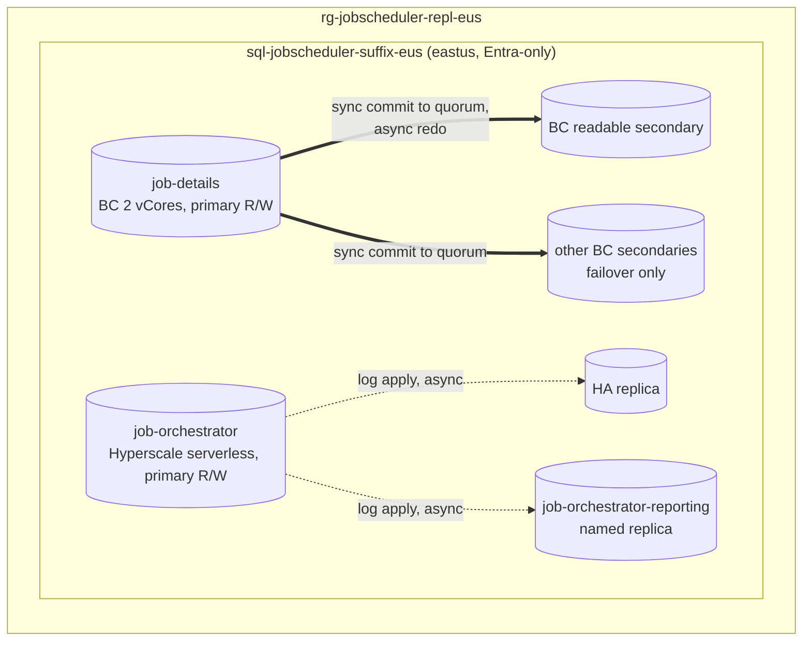

# Distributed Data and Replication: Design

**Platform:** Azure. **Scope:** UC 1.1 Create a New Job, UC 2.1 Execute a Job At a Scheduled Time.

`job-details` holds `Job`, `JobSchedule`, `JobLaunchDetails`, `JobOutbox`. `job-orchestrator` holds `JobScheduleSnapshot`, `JobRun`, `JobRunOutbox`. A transactional outbox relays changes from the first to the second, and the snapshot is written by a version-guarded upsert. UC 1.1 uses `job-details` plus the snapshot upsert. UC 2.1 uses `job-orchestrator` and `job-outputs`.

## 1. Overview

| Component | Database | Use case | Tier | Replicas | Read routing |
|---|---|---|---|---|---|
| Job Manager | `job-details` | UC 1.1 | Azure SQL DB Business Critical (BC), Gen5, 2 vCores | Built-in set, up to 3 secondaries, 1 readable | `ReadOnly` → readable secondary |
| Job Orchestrator | `job-orchestrator` | UC 1.1 (snapshot) + UC 2.1 | Azure SQL Hyperscale (demo serverless, prod provisioned), Gen5 | 1 HA + 1 named (`job-orchestrator-reporting`) | `ReadOnly` → HA; `Reporting` → named |
| Runners | `job-outputs` | UC 2.1 | Cosmos DB (analysis only, not deployed) | 4 replicas per physical partition, 1 write region | n/a |

Load assumptions: 100,000 users, 20,000 daily active, 10 active jobs per user, so 1,000,000 jobs. At 10 runs per job per day that is 10,000,000 runs a day.

## 2. Requirements

| Aspect | `job-details` | `job-orchestrator` | `job-outputs` |
|---|---|---|---|
| Volume | 5 GB, ≤20 GB in 3 years | ≈0.5 TB | 1.5 TB (30-day TTL) |
| Writes | 0.5/s avg, 5/s peak, design 50/s | 116 runs/s avg, 5,000 burst | 1,200/s avg, 50,000 peak |
| Reads | 12/s avg, 120 peak, design 500/s | 50–200/s, analytical | ≈50/s by `RunId` |
| Consistency | Writes strong; lists eventual | Claim, lock, status strong; history eventual | Session |
| Availability | 99.99%, RPO 0, RTO seconds | 99.99%, RPO 0, RTO <1 min | 99.99% (99.995% with AZs) |
| Geography | East US, single region | East US; prod DR passive in West US | East US write region, optional read region |

- `job-details` volume: job ≈3 KB (4 KB with indexes) × 1M = 4 GB. Outbox: 40,000 msgs/day × 2.5 KB = 100 MB/day, 7-day retention, purged by a scheduled cleanup job outside the DAL ≈ 0.7 GB.
- `job-details` load: 20,000 users × 2 writes = 40,000/day ÷ 86,400 s = 0.5/s. 20,000 × 50 views = 1M reads/day ≈ 12/s. Peak = 10×. Read:write ≈ 25:1.
- `job-details` consistency: job names are unique per user, and the job row and outbox row commit together. The creator reads `Strong`. Lists are `Eventual` and can briefly miss a fresh change (§6).
- `job-details` availability: 99.99% = 52.6 min/year. RPO 0 = commit hardened on a quorum. RTO in seconds = automatic failover to a secondary that has the data. An outage stops job creation, but scheduled runs continue because the orchestrator holds its own copy. Demo: no regional DR, no zone redundancy. Production: zone redundancy (free on BC, SLA 99.995%) and an optional geo-secondary in a failover group (RPO ≤5 s).
- `job-orchestrator` volume: snapshots 3 GB. `JobRun` 0.5 KB × 10M = 5 GB/day × 90 days hot = 450 GB (older archived). Run outbox 10M × 3 KB = 30 GB/day, purged after 48 h by a scheduled cleanup job outside the DAL ≈ 60 GB. Hyperscale (up to 128 TB) fits.
- `job-orchestrator` writes: 10M ÷ 86,400 ≈ 116 runs/s. 10M ÷ 24 ≈ 417k/hour. Half aligned to :00 and due within 40 s: 208k ÷ 40 ≈ 5,000 runs/s. A run costs 6 writes (claim update, `JobRun` insert, outbox insert, 2 status compare-and-sets (CAS), lock release). Average ≈ 700 row writes/s. Burst = 30,000 row writes/s ≈ 50 claim transactions/s (100-row batches) + ≈15,000 single-row commits/s. The commit rate sizes the primary.
- `job-orchestrator` reads: stuck-run scans every 10 s plus history. Writes dominate (700/s vs ≤200/s).
- `job-orchestrator` geography: one writer, never active-active. The DR region stays passive. Production: zone redundancy plus a Hyperscale geo-secondary in West US in its own failover group.
- UC 1.1 on the orchestrator: one snapshot upsert per create or edit (0.5/s avg, 5/s peak). The version guard makes duplicates and reordering harmless, so the relay is eventually consistent by design.
- `job-outputs`: 10 entries × 0.5 KB × 10M runs = 50 GB/day. Session: a writer reads its own logs, others are eventual.

## 3. Database choice

**`job-details`: SQL, Azure SQL Database BC, PaaS.**
- SQL: a job is a small relational aggregate written in one ACID transaction. Uniqueness (user + name, non-deleted) is a filtered unique index. At 5 GB and 50 writes/s, NoSQL write scaling gains nothing and loses the constraint and the transaction.
- PaaS: patching, backups, local replica set with automatic failover and read scale-out. Self-hosting would mean building replication for no benefit.
- Pros: 99.99% (99.995% zone-redundant, no charge); constraints and transactions; free readable secondary; RPO 0 and failover in seconds; local SSD; fully managed.
- Cons: provisioned only (no serverless, no auto-pause), costs noticeably more than GP serverless; 2 vCores minimum; one readable secondary, lag unbounded; no regional DR without geo-replication; vertical scaling.
- Rejected, GP serverless without replica: no readable copy, slower failover (compute reattaches remote storage).
- Rejected, GP serverless + readable geo-secondary + failover group: every eventual read pays cross-region async lag, and it needs a second server. It answers regional DR, not local reads.
- Rejected, Hyperscale: built for far more than 5 GB. One HA replica gives 99.95%, below target.

**`job-orchestrator`: SQL, Azure SQL Hyperscale (demo serverless, prod provisioned), PaaS.**
- SQL: "which jobs are due" is a range query on `NextRunAt`. The claim needs row locks (`UPDLOCK, READPAST, ROWLOCK`), a conditional singleton-lock update and CAS status updates. These are atomic in T-SQL and hard to do safely in a key-value store. The same database serves UC 1.1 snapshots, so there is no second store.
- PaaS: storage grows automatically, replicas are added in minutes regardless of size.
- Pros: up to 128 TB; log service gives RPO 0 on compute failure; up to 4 HA replicas plus named replicas.
- Cons: SLA depends on HA replica count (0: 99.9%, 1: 99.95%, 2+: 99.99%); replicas are async, so reads can be stale; no auto-pause on serverless here, so minimum vCores always bill; named replicas are not failover targets.
- SLA gap: the demo has 1 HA replica (99.95%, below target). Production uses 2 or more.

**`job-outputs`: NoSQL, Cosmos DB, PaaS. Analysis only, not deployed.** Data is append-only documents with no joins or cross-document transactions. `RunId` is the partition key, TTL removes old data for free, autoscale absorbs bursts. At ≈5 RU per insert, autoscale max ≈250,000 RU/s. Index only `RunId` and `Timestamp`. Cost: RU pricing and no relational constraints, both acceptable for logs.

Out of scope: Service Bus queues and Blob payloads are not databases here. Queue replication in production: Service Bus Premium geo-disaster recovery.

## 4. Replication

**`job-details`**
- Why: (1) HA, so a node failure loses no committed job and recovers in seconds; (2) the secondary has its own compute, so heavy list and dashboard reads cannot starve the primary.
- Default: single leader. One primary plus up to 3 secondaries (Always On availability group technology), each on local SSD. A commit is acknowledged after it is hardened on the primary and a quorum of secondaries: synchronous, RPO 0, automatic failover in seconds. Log redo on secondaries is async, so the one readable secondary (read scale-out, `ApplicationIntent=ReadOnly`, on by default, free) is eventually consistent. Lag is typically tens of ms to seconds with no ceiling. It grows on a busy replica or large transactions, so it is measured. Microsoft: "in Premium and Business Critical service tiers, only one of the read-only replicas is accessible at any given time". The choice is not configurable, reads are not load-balanced, and other secondaries are failover targets only. Replica reads use snapshot isolation.

**`job-orchestrator`**
- Why: (1) history queries over 450 GB must not compete with 30,000 writes/s bursts, so history uses a named replica; (2) HA: the HA replica is the failover target; (3) light monitoring reads use the HA replica.
- Default: single leader, one read-write primary compute. Commits are hardened synchronously in the log service (durable landing zone), so a compute failure loses nothing. HA and named replicas apply the log asynchronously. Lag is typically ms to seconds and is measured. An HA replica is a failover target and a read scale-out (`ApplicationIntent=ReadOnly`). A named replica is a separate read-only database name with its own compute size and is not a failover target.
- Decision: one scheduler leader runs the loop, elected by Blob Storage lease. If it is not enough, shard by `JobId`.

**`job-outputs`**
- Why: durability and availability of the log store, because the write path must not fail.
- Default: each physical partition is a 4-replica set in the region. Leader-based, synchronous in region, and a write commits by majority quorum (3 of 4).

| Parameter | `job-details` | `job-orchestrator` | `job-outputs` |
|---|---|---|---|
| Primary | BC 2 vCores, `sql-jobscheduler-<suffix>-eus` | Demo: serverless 0.5–2 vCores. Prod: provisioned `HS_Gen5_16`–`24`* | 1 write region (East US) |
| Replicas | ≤3 in-region secondaries, 1 readable | Demo: 1 HA + 1 named. Prod: 2 HA + ≥1 named, sized like primary | 4 replicas per physical partition; optional async read region |
| Sync / async | Commit sync to quorum; redo async | Commit sync to log service; replica apply async | Sync in region; read region async |
| Quorum | Fixed by service | None (no quorum or leaderless reads) | 3 of 4, fixed |
| Read access | `ApplicationIntent=ReadOnly` | HA: same. Named: `Database=job-orchestrator-reporting` | Session token |
| Zone redundancy | Demo off. Prod on | Demo off. Prod on | Prod on |
| DR | Demo none. Prod optional geo-secondary (RPO ≤5 s) | Demo none. Prod geo-secondary, West US, own failover group | Optional read region; no multi-region writes |
| Failover target | Any secondary, automatic | HA yes, named no | Read region, if added |
| SLA | 99.99% | Demo 99.95%. Prod 99.99% | 99.99% |

\*Starting point, to be confirmed by a load test. The demo uses locally redundant backups.

**Capacity, demo vs production.** The demo primary `HS_S_Gen5_2` (0.5–2 vCores, 6 GB memory, 150 workers) shows topology, routing and lag on a three-job seed. It is not sized for, or tested against, the 30,000 writes/s burst. Limits per Microsoft Learn ([vCore limits](https://learn.microsoft.com/azure/azure-sql/database/resource-limits-vcore-single-databases), [diagnostics](https://learn.microsoft.com/azure/azure-sql/database/hyperscale-performance-diagnostics)):

- CPU/commits: the main driver. 2 vCores ≈ one physical core, so the demo saturates far below ≈15,000 commits/s. Production needs more vCores and batched runner status writes.
- Workers: not the limit. ≈15,000 × 4 ms ≈ 60 concurrent; `HS_Gen5_16` has 1,600.
- Log rate: ≈ 5,000 × 4 KB ≈ 20 MB/s, ≈40 MB/s with overhead, against a cap of 100 MiB/s at every size from 2 to 80 vCores. Premium-series raises it to 150 MiB/s, the step before sharding. Beyond about 2× today's burst, shard; more vCores do not help.
- Memory: `HS_Gen5_16`–`24` has 83–125 GB, which keeps the hot claim path in memory.
- Provisioned vs serverless: production is provisioned, not serverless. At 116 runs/s the database never idles, and a cold scale-up would hit the cron boundary.
- Replica throttling: replicas can slow the primary. Hyperscale throttles log rate while an HA or named replica lags on log apply (wait `RBIO_RG_REPLICA`, per-replica backlog in `sys.dm_hs_database_log_rate()`). A named replica isolates CPU and memory, not log apply, so size replicas for apply as well as queries.
- Claim throughput: the DAL claims in 100-row batches inside one transaction, so there is one commit per batch. Statements are still per row, about 250 runs/s per leader, so 5,000 runs/s needs a set-based claim (table-valued parameter plus `UPDATE ... OUTPUT`), to be confirmed by a load test.
- Other mitigations: batched status writes, `UPDLOCK, READPAST` (safe overlapping claimers during a leader handover), and a few seconds of jitter for `:00` jobs.

## 5. Read/write routing

`Strong` = `ReadWrite`. `Eventual` = `ReadOnly` (default for reads that accept lag).

| Role | Operations | `job-details` | `job-orchestrator` |
|---|---|---|---|
| `ReadWrite` | Create, update, soft delete job; outbox read/mark (3) | Primary | n/a |
| `ReadWrite` | `UpsertAsync`; `ClaimDueJobsAsync`; `TryUpdateStatusAsync`; `ReleaseLockAsync`; `SetServiceBusSequenceNumberAsync`; run outbox read/mark | n/a | Primary |
| `Eventual` / `Strong` | `GetJobAsync`, snapshot `GetAsync`, `GetRunAsync` | Secondary / primary | HA replica / primary |
| `ReadOnly` | `ListJobsByUserAsync`, `GetOverdueRunsAsync` | Secondary | HA replica |
| `Reporting` | `GetRunHistoryAsync` | Falls back to `ReadOnly` | Named replica |

Both outbox reads are `ReadWrite` on purpose: a lagging outbox would delay delivery and race with marking a message processed.

## 6. Consequences and anomalies

- **Read-your-writes**: after a create or edit, `Eventual` reads on a secondary can be seconds behind → create returns the view built in memory, update and soft delete return the new version, and `GetJobAsync(Strong)` reads the primary. Gap: `ListJobsByUserAsync` reads the copy, so after a create, rename or delete the list can briefly be out of date. Accepted. Future improvement: writes return a version or timestamp token, and list reads accept it and fall back to the primary when the copy is behind.
- **Monotonic reads**: demo has one readable copy per database, so consecutive `ReadOnly` reads do not go back, except after a BC failover. With 2+ HA replicas in production, `job-orchestrator` reads can hit replicas with different lag. A `Strong` read followed by `Eventual` can go back (version 4 in the edit form, then 3 in the list) → callers that need monotonic results use `Strong` or `Reporting` (one named replica). Everything else accepts it.
- **Stale Redis refill**: a cache miss right after a write can refill Redis from the lagging secondary → the BFF deletes the job and user-list keys after the write and again after ≈5 s (the lag alert threshold, §7). TTL is the backstop.
- **Lost updates from stale edit forms**: two users or tabs save the same job in turn → every update and delete is a CAS on `Version` (`WHERE Id = @JobId AND Version = @ExpectedVersion`). Zero rows raises a concurrency conflict, proven by an integration test. A form loaded with `Eventual` may carry an old version and get a false conflict, with no data loss, so edit forms load `Strong`. On conflict the caller reloads `Strong` and the user re-applies. On the orchestrator side, duplicated or reordered outbox messages are dropped by the version-guarded upsert.
- **Stale stuck-run scans**: the monitor scans every 10 s on the HA replica, whose lag peaks at the top-of-minute burst, so it can show a finished run as `Running` or `Pending` past its `Deadline` or detect a stuck run late → the replica only nominates candidates. Every action is a CAS on the primary, so a false positive is a no-op and a terminal status is never overwritten. The claim takes over an expired lease itself (`LockedUntil < @UtcNow`), so scheduling never waits for the scan. Late detection only delays `TimedOut` by up to 10 s plus lag.
- **Duplicate ExecuteJob delivery**: run-outbox relays overlap during a leader handover, and Service Bus delivers at least once → messages use `MessageId = RunId`, and Service Bus duplicate detection drops the copy.
- **Edit of a fired one-time job**: the snapshot upsert keeps a one-time job `Inactive` when a run already exists for its `StartAt` → the edit does not fire it again, and moving `StartAt` to a new time reactivates it. A `Deleted` status is never overridden. The claim inserts the run before it takes the singleton lock, so a skipped duplicate window never leaves a lock behind.
- **Torn reads**: an `Eventual` read during a create → the four UC 1.1 rows commit in one transaction, a replica shows changes only after the commit record is redone, and reads use snapshot isolation. A reader sees the whole job or nothing.
- **No cross-database consistency**: `job-details` and `job-orchestrator` replicate independently → the outbox plus version-guarded upsert cover the normal case. In-region failovers are RPO 0, so a relayed message never refers to a lost write. Demo: nothing extra. With async geo-DR in production, a forced regional failover opens a window of ≈5 s of loss → prefer planned failover, optionally wait for `sp_wait_for_database_copy_sync` before relaying, and reconcile by job id and version. Documented only.
- **Transient errors during failover** (BC replica set, Hyperscale HA, replica reconfiguration): connections drop, and a drop right after `COMMIT` leaves the outcome unknown → the DAL retries (§9.3).
- **Read-only routing depends on the readable replica**: `ReadOnly` connections fail during reconfiguration or land on the replica that took over → the same retries. Reads that cannot tolerate lag or a switch use `Strong`.

## 7. Replication lag monitoring

Demo: lag is measured, not monitored. Integration tests print the lag of the readable secondary and the HA replica, and setup inspects `sys.dm_database_replica_states`. Production signals ([read scale-out](https://learn.microsoft.com/azure/azure-sql/database/read-scale-out), [diagnostics](https://learn.microsoft.com/azure/azure-sql/database/hyperscale-performance-diagnostics)), thresholds to be tuned from a baseline:

| Signal | Threshold | Reaction |
|---|---|---|
| BC: `redo_queue_size` ÷ `redo_rate` (`sys.dm_database_replica_states`) ≈ lag in s | >5 s for 5 min | Warning |
| Hyperscale: `sys.dm_hs_database_log_rate()`, `RBIO_RG_REPLICA` waits | Wait time growing | Warning: replica throttles claimers |
| Optional heartbeat row on primary, read via `ReadOnly` (outside the DAL) | >5 s for 5 min | Warning |
| DAL retry warnings | Any for 2 min | Warning: failover in progress |

Collection: database watcher (preview) or a scheduled job writing these views to Log Analytics. Decision: alert only, no automatic rerouting. Reason: rerouting hides replica problems and couples reads to primary load. Lag-intolerant reads already use `Strong` or end in a CAS on the primary.

## 8. Topology and setup

The topology is built by hand in the Azure Portal, East US: resource group `rg-jobscheduler-repl-eus`; server `sql-jobscheduler-<suffix>-eus` with Entra-only auth (no SQL logins, no passwords); `job-details` (BC, 2 vCores, read scale-out on); `job-orchestrator` (Hyperscale serverless, 1 HA replica); named replica `job-orchestrator-reporting` on the same server.

Seed (idempotent scripts): 3 jobs for 2 users with fixed ids. `job-details`: 3 rows each in `Job`, `JobSchedule`, `JobLaunchDetails`, `JobOutbox`. `job-orchestrator`: 3 `JobScheduleSnapshot`, 2 `JobRun`, 2 `JobRunOutbox`.

Verification plan: on each target, query server identity and writability, then read the seeded row counts. On both replica kinds, attempt a write and expect error 3906 (database is read-only).

| # | Target | Expected `Updateability` |
|---|---|---|
| 1 | `job-details` primary | `READ_WRITE` |
| 2 | `job-details` secondary (`ApplicationIntent=ReadOnly`) | `READ_ONLY`, same server name |
| 3 | `job-orchestrator` primary | `READ_WRITE` |
| 4 | `job-orchestrator` HA replica (`ApplicationIntent=ReadOnly`) | `READ_ONLY` |
| 5 | `job-orchestrator-reporting` | `READ_ONLY` |

Setup evidence is attached to the DAL project.

## 9. Data access layer

### 9.1 Structure

Plain class library, no host. Repositories obtain connections only through a connection factory.

- Connections: roles (`ReadWrite`, `ReadOnly`, `Reporting`), consistency levels (`Strong`, `Eventual`), per-database options, a pure routing function, the factory, an Azure AD token provider.
- Job details: job repository, CRUD plus outbox (UC 1.1).
- Job orchestrator: snapshot and run repositories: upsert, claim, status CAS, overdue scan, history (UC 1.1, 2.1).
- Registration: one dependency injection call from configuration.

### 9.2 Routing

One routing function, one connection string per database. The role changes only the application intent or the database name.

- `ReadWrite`: the connection string, reaching the primary.
- `ReadOnly`: plus `ApplicationIntent=ReadOnly`, reaching the readable secondary (`job-details`) or HA replica (`job-orchestrator`).
- `Reporting`: falls back to `ReadOnly` on `job-details`. On `job-orchestrator`, reporting database name plus `ReadOnly` intent, reaching the named replica.

The function is pure (options and role in, connection string out; no state, no I/O), so it is unit-testable. An unknown role is rejected, never defaulted to the primary. Auth uses an access token from a credential (default Azure chain, so `az login` works locally), so connection strings hold no secrets. Every opened connection logs the requested and effective role, intent and target at Debug level, which is the routing proof.

### 9.3 Retries

Polly, exponential backoff with jitter, 5 attempts (configurable). Each attempt re-runs the whole unit of work on a new connection and logs a warning. One wrapper covers every repository method, and the caller gets the SQL exception after the last attempt.

- Reads and naturally idempotent writes are repeated.
- Non-idempotent writes (job create, update, soft delete) reconcile an earlier attempt that may have committed, for example by looking for its outbox row.
- The claim is re-run. The snapshot has already advanced, so nothing is claimed twice. The run outbox, not the returned list, is the record of what was claimed.
- The status CAS re-reads the run on the primary at 0 rows and returns `true` if the status equals the target. Lock release is idempotent: releasing a lock no longer held by that `RunId` is a no-op.
- The outbox `Attempts` counter may over-count by one after a lost acknowledgement. It only drives backoff, so this is accepted.
- SqlClient's built-in retry is not used: it retries single commands and cannot recover a multi-statement transaction.
- A commit can succeed while the connection drops, so a resubmit after final failure may get "name already exists" or a version conflict.

### 9.4 Why Dapper

- The important SQL is hand-written and EF cannot express it: the `UPDLOCK, READPAST, ROWLOCK` claim, the conditional singleton-lock update, the version-guarded upsert with a 2627 fallback. There is no object graph to track (UC 1.1 is four INSERTs in one transaction).
- Routing lives in one place, the connection factory. EF would need it twice (DbContexts and Dapper) plus shared-transaction plumbing. Schema comes from idempotent SQL scripts, so no migrations.
- Cost: manual mapping and SQL strings for 7 tables.

### 9.5 Tests

Unit tests (no Azure): routing for every role, next-run calculation, snapshot mapper, status transitions. Integration tests run against real Azure and skip when it is not configured. They prove: routing reaches every target (database name and `Updateability`); a write is rejected with error 3906 on both replica kinds; replication lag is measured and printed; CRUD for both repositories, including the stale-version conflict; overlapping claimers never claim the same job; soft delete with a stale version, and its retry; a fired one-time job is not claimed again after an edit; the claim skips a row whose run already exists without leaking the singleton lock.
