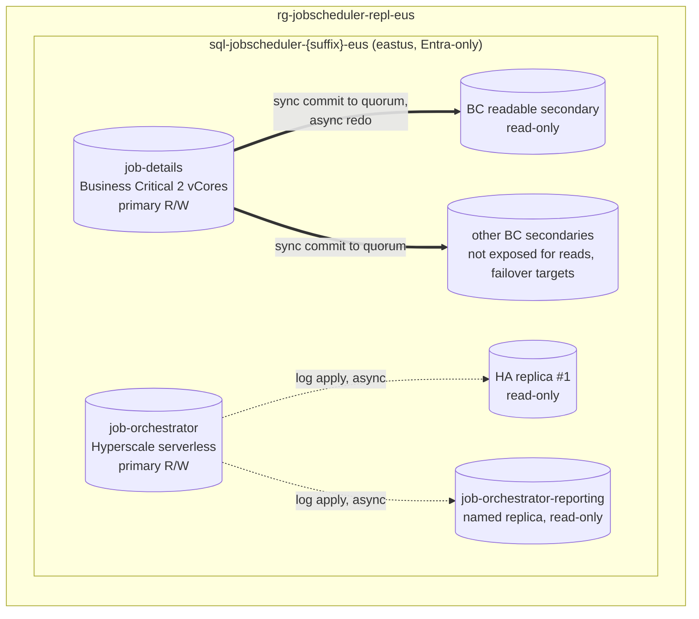

# Azure Portal setup guide — replicated `job-details` / `job-orchestrator`

This is the **configuration document** for lesson 4.2 (task §2). You build the replicated topology **by hand in the Azure Portal**, apply the SQL scripts from [`../../db/`](../../db/README.md), verify replication, configure the DAL, and tear everything down. There is no IaC and there are no scripts: the point is to learn where every replication setting lives. `az` is used only for `az login` and read-only checks (`show` / `list` / `exists`).

> ## ⚠️ COST WARNING
> **~$2.03/h while it exists (≈ $49/day if forgotten — about the whole $50 monthly credit) — delete the resource group in the same session** (step 10). `job-details` is provisioned Business Critical and bills $1.36/h flat; nothing here auto-pauses. Create the budget alert in step 0 **before** creating any resource.

Contents: [Reference](#reference) · [Step 0](#0-before-you-start) · [1](#1-resource-group) · [2](#2-logical-server) · [3](#3-job-details) · [4](#4-job-orchestrator) · [5](#5-named-replica) · [6](#6-apply-the-schema-and-seed) · [7](#7-verify-replication) · [8](#8-observe-replication-learning) · [9](#9-configure-the-dal) · [10](#10-teardown) · [11](#11-troubleshooting)

---

## Reference

### 1. Topology



`<suffix>` is a short lowercase token you pick once (e.g. `oa42`) so the server name is globally unique. Use it verbatim in every name.

| Resource | Name | Region | Notes |
|---|---|---|---|
| Resource group | `rg-jobscheduler-repl-eus` | eastus | holds everything; tags `project=job-scheduler`, `lesson=4.2-replication` on every resource |
| Logical server | `sql-jobscheduler-<suffix>-eus` | eastus | hosts `job-details`, `job-orchestrator`, `job-orchestrator-reporting` |

The BC secondaries and the Hyperscale HA replica are **not separate resources**: they come with the database and share its name and server.

### 2. Configuration parameters

**Database settings** (the step-by-step part uses exactly these values):

| Setting | `job-details` | `job-orchestrator` | `job-orchestrator-reporting` |
|---|---|---|---|
| Service tier / compute | Business Critical, **Provisioned**, Gen5 (`BC_Gen5_2`) | Hyperscale, **Serverless**, Gen5 (`HS_S_Gen5`) | Hyperscale named replica, Serverless Gen5 |
| vCores | 2 (smallest BC size) | max 2 / min 0.5 | max 2 / min 0.5 |
| Auto-pause | n/a (provisioned) | n/a (Hyperscale serverless has no auto-pause) | n/a |
| Replicas | BC built-in: up to 3 secondaries, **only one** readable at a time; **Read scale-out = Enabled** | **1** HA replica | 0 HA replicas |
| Zone redundancy | No | No | No |
| Backup storage redundancy | Locally-redundant (LRS) | LRS | (inherits) |
| Replication | BC replica set: synchronous commit to a quorum of secondaries, asynchronous redo on the readable secondary | log service → HA replica + named replica (async apply) | named replica of `job-orchestrator`, same server. If serverless is not offered for named replicas, use provisioned Hyperscale Gen5 2 vCores |

**Server settings:**

| Setting | Value |
|---|---|
| Authentication | **Microsoft Entra-only authentication**; Entra admin = the signed-in user; no SQL admin login/password |
| Networking | public endpoint; firewall rule *Add your client IPv4 address* (rule name `allow-client-ip`); *Allow Azure services and resources to access this server* = **No** |
| Minimum TLS version | **1.2** |
| Connection policy | Default |
| Tags | `project=job-scheduler`, `lesson=4.2-replication` |

### 3. Replication mode per database

**`job-details` — Business Critical**
- Single leader: one R/W primary replica.
- The database runs on a replica set of 1 primary + **up to 3 secondaries** (Always On availability-group technology). Each replica has its own copy of the data on **local SSD**.
- A commit is acknowledged only after it is hardened on the primary **and a quorum of secondaries** (synchronous commit). So a node failure loses nothing (**RPO 0**), and the service fails over automatically within seconds.
- The log **redo** on the secondaries is asynchronous. The one **readable secondary** (read scale-out, reached with `ApplicationIntent=ReadOnly` on the primary's connection string, no extra cost) is therefore eventually consistent; the lag is typically tens of milliseconds to single-digit seconds, with **no fixed upper bound** (it grows when the replica is busy).
- **Only one secondary is readable at any given time.** You can't choose it, and there is no load-balancing across secondaries. If a different secondary becomes the readable one (after a failover), a reconnecting session may see a slightly different point in time.
- Quorum settings: **applicable, but fixed by the service** (commit quorum of the replica set; not configurable). There are no leaderless/quorum reads.
- No geo-replication in the demo. Regional DR (a geo-secondary in a failover group, asynchronous, RPO ≤ 5 s) is a production option only.

**`job-orchestrator` — Hyperscale**
- Single leader: one R/W primary compute.
- Commits are hardened **synchronously** in the Hyperscale **log service** (durable landing zone), so compute failure loses nothing (RPO 0).
- The **HA replica** and the **named replica** are compute nodes that apply the log **asynchronously**, so reads on them are eventually consistent (lag typically milliseconds to seconds).
- HA replica: a **failover target** and a read scale-out reached with `ApplicationIntent=ReadOnly` on the primary's connection string.
- Named replica: an independent read-only database name on the same server with its own compute size. It is **not** a failover target, which is why it is the right place for history and reporting queries.
- Quorum settings: **N/A** (no quorum or leaderless reads in Hyperscale).

### 4. Read routing

DAL role → connection string → physical target (see [§9.2 Routing](../../../04_02_distributed_data_replication/03-home-task-solution.md#92-routing)). `ReadConsistency.Strong` → `ReadWrite`, `ReadConsistency.Eventual` → `ReadOnly`. Both databases use the **same server name** for every role; the gateway routes by application intent.

| Database | DAL role | Connection string used (key) | Router adds | Physical target |
|---|---|---|---|---|
| `job-details` | `ReadWrite` | `JobDetails:ConnectionString` (eus server) | `ApplicationIntent=ReadWrite` | BC primary replica |
| `job-details` | `ReadOnly` | `JobDetails:ConnectionString` | `ApplicationIntent=ReadOnly` | BC readable secondary |
| `job-details` | `Reporting` | no `ReportingDatabase` ⇒ falls back to the `ReadOnly` rule | `ApplicationIntent=ReadOnly` | BC readable secondary |
| `job-orchestrator` | `ReadWrite` | `JobOrchestrator:ConnectionString` (eus server) | `ApplicationIntent=ReadWrite` | primary |
| `job-orchestrator` | `ReadOnly` | `JobOrchestrator:ConnectionString` | `ApplicationIntent=ReadOnly` | HA replica |
| `job-orchestrator` | `Reporting` | `JobOrchestrator:ConnectionString` with `Database` swapped to `JobOrchestrator:ReportingDatabase` | `ApplicationIntent=ReadOnly` | named replica `job-orchestrator-reporting` |

### 5. Cost

Prices from the Azure Retail Prices API (checked 2026-11-17, USD, eastus):

| Meter | Price |
|---|---|
| Business Critical Gen5 compute, 2 vCores (provisioned), per hour | **$0.60887** |
| Business Critical SQL license, per vCore-hour | **$0.375** |
| Hyperscale serverless primary compute, per vCore-hour | **$0.585** |
| Hyperscale serverless replica (HA or named) compute, per vCore-hour | **$0.378** |

No auto-pause anywhere, so every database bills while it exists. The BC readable secondary is included in the BC price. Storage is negligible.

| Idle cost | $/h |
|---|---|
| `job-details` BC 2 vCores: 0.60887 + 2 × 0.375 | 1.359 |
| `job-orchestrator` primary (0.5 vCore floor): 0.5 × 0.585 | 0.293 |
| HA replica + named replica (0.5 vCore floor): 2 × 0.5 × 0.378 | 0.378 |
| **Total** | **≈ $2.03/h ≈ $49/day** |

Under test load (Hyperscale at 2 vCores) it can reach ~$4/h; a 3-hour session costs roughly $6–12. **Always delete the resource group in the same session.**

---

## Step-by-step

Every step: **Portal path** → **field = value** → *why*, then a **✅ Check**. Screenshots go to `04_02_distributed_data_replication/evidence/` (folder is created in step 7; create it earlier if you want to save screenshots sooner). Portal labels shift slightly between releases; if a label differs, pick the closest one and keep the **values**.

### 0. Before you start

1. **Tools**: run these in a terminal and check the output.
   ```bash
   az login                              # the account that owns the subscription
   az account show --query "{name:name, id:id, user:user.name}" -o table
   brew install sqlcmd                   # go-sqlcmd (Entra auth, no passwords)
   sqlcmd --version
   dotnet --version                      # needs the .NET 10 SDK
   ```
   *Why:* `az login` provides the token that `sqlcmd` (`ActiveDirectoryDefault`) and the DAL (`DefaultAzureCredential`) reuse.
   ✅ Check: `az account show` prints the subscription you intend to pay with (the lesson plan assumes "Visual Studio Professional Subscription"; if it is not the active one, run `az account set --subscription "<name>"` and re-check). `sqlcmd --version` prints a version; `dotnet --version` starts with `10.`.
2. **Choose `<suffix>`**: a short lowercase token, e.g. `oa42`. Keep it for the whole guide. *Why:* server names are global DNS names.
3. **Budget alert**: *Cost Management + Billing → Cost Management → Budgets → + Add* → scope = your subscription; name `lesson-4-2-budget`; amount = **20** USD (monthly); alert conditions = **50 %, 90 %, 100 %** of actual cost, recipient = your e-mail. *Why:* the stack bills ~$2.03/h even when idle, so $20 is reached in about 10 hours.
   ✅ Check: the budget appears in the *Budgets* list.
4. **Look up your Entra UPN** (needed for the Entra admin in step 2):
   ```bash
   az ad signed-in-user show --query userPrincipalName -o tsv
   ```
   ✅ Check: prints something like `first.last@yourtenant.onmicrosoft.com`.
5. **Define the shell variables** used later (re-define them in every new terminal; edit `SUFFIX`):
   ```bash
   export SUFFIX="oa42"
   export EUS_FQDN="sql-jobscheduler-${SUFFIX}-eus.database.windows.net"
   echo "$EUS_FQDN"
   ```
   ✅ Check: the host name prints with your suffix. The server does not exist yet; DNS resolves only after step 2.

### 1. Resource group

1. *Resource groups → + Create*.
2. **Subscription** = your subscription · **Resource group** = `rg-jobscheduler-repl-eus` · **Region** = `East US`. *Why:* one group means a single delete removes everything in step 10.
3. *Tags* tab: `project` = `job-scheduler`, `lesson` = `4.2-replication`. *Why:* you can find leftovers in Cost Management by tag.
4. *Review + create → Create*.

✅ Check: `az group exists -n rg-jobscheduler-repl-eus` prints `true`; the group shows both tags.

### 2. Logical server

1. *SQL servers → + Create* (the standalone path; the database wizard can create a server inline, which is also fine).
2. *Basics*: **Resource group** = `rg-jobscheduler-repl-eus` · **Server name** = `sql-jobscheduler-<suffix>-eus` · **Location** = `(US) East US`.
3. **Authentication method** = `Use Microsoft Entra-only authentication` → *Set admin* → select **yourself** (the UPN from step 0). *Why:* no SQL logins and no passwords anywhere.
4. *Networking* tab: **Connectivity method** = `Public endpoint` · **Allow Azure services and resources to access this server** = **No** · **Add current client IP address** = **Yes**. *Why:* only your machine needs access; the wizard names the rule `ClientIPAddress_…`, which is fine. Connection policy stays **Default**.
5. *Security* tab: **Minimum TLS version** = `1.2`.
6. *Tags* tab: `project=job-scheduler`, `lesson=4.2-replication`. *Review + create → Create*.

✅ Check: the server opens; *Settings → Microsoft Entra ID* shows you as admin with "Microsoft Entra authentication only" ticked; *Security → Networking* lists your IP.

### 3. `job-details`

1. Open the server → *Databases → + Create database* (or *SQL databases → + Create*).
2. *Basics*: **Resource group** = `rg-jobscheduler-repl-eus` · **Database name** = `job-details` · **Server** = `sql-jobscheduler-<suffix>-eus` · **Workload environment** = `Production` (the `Development` preset may hide Business Critical).
3. **Compute + storage → Configure database**: **Service tier** = `Business Critical (…)` · **Compute tier** = **Provisioned** (the only option for BC) · **Hardware** = `Standard-series (Gen5)` · **vCores** = `2` · **Read scale-out** = **Enabled** · *Apply*. *Why:* BC gives an in-region **readable secondary** for the 25:1 read load at no extra cost, and quorum commit (RPO 0). 2 vCores is the smallest BC size.
4. **Backup storage redundancy** = `Locally-redundant backup storage` · **Zone redundant** = **No**. *Why:* cheapest; the demo does not need zone redundancy (production would: 99.995%, no extra charge on BC).
5. *Additional settings*: **Use existing data** = `None`. *Tags*: `project=job-scheduler`, `lesson=4.2-replication`. *Review + create → Create*.
6. 📸 Screenshot: the *Compute + storage* blade of `job-details` showing Business Critical / Provisioned / 2 vCores / Read scale-out Enabled → `portal_job_details_compute.png`.

✅ Check: *job-details → Overview* shows Status `Online`, Pricing tier `Business Critical: Standard-series (Gen5), 2 vCores`. Read-only CLI check:
```bash
az sql db show -g rg-jobscheduler-repl-eus -s "sql-jobscheduler-${SUFFIX}-eus" -n job-details --query "{sku:currentServiceObjectiveName, readScale:readScale, zoneRedundant:zoneRedundant}" -o table
```
prints `BC_Gen5_2`, `Enabled`, `False`.

### 4. `job-orchestrator`

1. Same server (`sql-jobscheduler-<suffix>-eus`) → *+ Create database*.
2. *Basics*: **Database name** = `job-orchestrator` · **Workload environment** = `Development`.
3. **Compute + storage → Configure database**: **Service tier** = **Hyperscale** · **Compute tier** = **Serverless** · **Hardware** = `Standard-series (Gen5)` · **Max vCores** = `2` · **Min vCores** = `0.5` · **High-availability secondary replicas** = **1** · *Apply*. *Why:* the orchestrator's write-heavy, TB-scale history needs Hyperscale; one HA replica gives a failover target and a read scale-out (99.95%; production uses 2).
4. **Backup storage redundancy** = `Locally-redundant` · **Zone redundant** = **No**.
5. *Additional settings*: **Use existing data** = `None`. *Tags* as before. *Review + create → Create*.

✅ Check: *job-orchestrator → Compute + storage* shows Hyperscale, Serverless, max 2 / min 0.5, **High-availability secondary replicas = 1**.

### 5. Named replica

1. *job-orchestrator → Data management → Replicas → + Create replica*.
2. **Replica type** = **Named replica** · **Server** = the **same** server · **Database name** = `job-orchestrator-reporting`.
3. **Compute + storage**: **Serverless**, Gen5, **Max vCores** = `2`, **Min vCores** = `0.5`, **High-availability secondary replicas** = `0`. *Why:* the named replica is an independent read-only database with its own compute, so reporting queries cannot slow the scheduler. It is **not** a failover target.
4. *Tags* as before. *Review + create → Create*. Wait for it to come online (a few minutes).
5. **Fallback** if serverless is not offered for named replicas: pick **Provisioned** Hyperscale, Gen5, **2 vCores**. Note the higher cost (billing at 2 vCores × $0.378/h ≈ $0.76/h instead of ≈ $0.19/h).
6. 📸 Screenshot (after the replica is online): the *Replicas* blade of `job-orchestrator` listing the HA replica and the named replica → `portal_job_orchestrator_replicas.png`.

✅ Check: the *Replicas* blade lists `job-orchestrator-reporting` as `Named replica`, status `Online`; the server's database list now shows it.

### 6. Apply the schema and seed

Run from `job-scheduler/` (the folder with `db/`). Re-run the step 0 variable block first if you opened a new terminal. Order matters: schema `001` before seed `002`; paths are quoted because the repo folder name contains `+`.

```bash
cd "/Users/oabdullaev/Documents/GitHubEpam/mentoring_advanced+/job-scheduler"

# job-details (primary replica: default application intent is ReadWrite)
sqlcmd -S "tcp:$EUS_FQDN,1433" -d job-details --authentication-method ActiveDirectoryDefault -b -i "db/job-details/001_schema.sql"
sqlcmd -S "tcp:$EUS_FQDN,1433" -d job-details --authentication-method ActiveDirectoryDefault -b -i "db/job-details/002_seed.sql"

# job-orchestrator (primary)
sqlcmd -S "tcp:$EUS_FQDN,1433" -d job-orchestrator --authentication-method ActiveDirectoryDefault -b -i "db/job-orchestrator/001_schema.sql"
sqlcmd -S "tcp:$EUS_FQDN,1433" -d job-orchestrator --authentication-method ActiveDirectoryDefault -b -i "db/job-orchestrator/002_seed.sql"
```

*Why:* `-b` aborts with a non-zero exit code on the first SQL error, `ActiveDirectoryDefault` reuses your `az login` token, and the seed is written only to the **primaries**: the replicas receive it by replication (writes on a replica fail with error 3906). The scripts are **idempotent** (`IF OBJECT_ID(...) IS NULL`, `IF NOT EXISTS ...` with fixed GUIDs), so a failed run can simply be repeated.

✅ Check: each `002_seed.sql` ends by printing its row counts:

| Seed script | Expected output (`TableName`, `RowCount`) |
|---|---|
| `job-details/002_seed.sql` | `Job 3`, `JobSchedule 3`, `JobLaunchDetails 3`, `JobOutbox 3` |
| `job-orchestrator/002_seed.sql` | `JobScheduleSnapshot 3`, `JobRun 2`, `JobRunOutbox 2` |

### 7. Verify replication

Run **five commands**, one per target (see [§8 Topology and setup](../../../04_02_distributed_data_replication/03-home-task-solution.md#8-topology-and-setup)). Targets 2 and 4 use `-K ReadOnly` (`ApplicationIntent=ReadOnly`); the read-only probe (`verify-replica-is-readonly.sql`) runs only on targets 2, 4 and 5. Everything goes to **one evidence file**; each block has a `### <target>` header.

```bash
cd "/Users/oabdullaev/Documents/GitHubEpam/mentoring_advanced+/job-scheduler"
mkdir -p "../04_02_distributed_data_replication/evidence"

{
  echo "### 1. job-details primary (eus server)"
  sqlcmd -S "tcp:$EUS_FQDN,1433" -d job-details --authentication-method ActiveDirectoryDefault -b -i "db/verify-replication.sql"

  echo "### 2. job-details BC readable secondary (eus server, -K ReadOnly)"
  sqlcmd -S "tcp:$EUS_FQDN,1433" -d job-details --authentication-method ActiveDirectoryDefault -K ReadOnly -b -i "db/verify-replication.sql"
  sqlcmd -S "tcp:$EUS_FQDN,1433" -d job-details --authentication-method ActiveDirectoryDefault -K ReadOnly -i "db/verify-replica-is-readonly.sql"

  echo "### 3. job-orchestrator primary (eus server)"
  sqlcmd -S "tcp:$EUS_FQDN,1433" -d job-orchestrator --authentication-method ActiveDirectoryDefault -b -i "db/verify-replication.sql"

  echo "### 4. job-orchestrator HA replica (eus server, -K ReadOnly)"
  sqlcmd -S "tcp:$EUS_FQDN,1433" -d job-orchestrator --authentication-method ActiveDirectoryDefault -K ReadOnly -b -i "db/verify-replication.sql"
  sqlcmd -S "tcp:$EUS_FQDN,1433" -d job-orchestrator --authentication-method ActiveDirectoryDefault -K ReadOnly -i "db/verify-replica-is-readonly.sql"

  echo "### 5. job-orchestrator-reporting named replica (eus server)"
  sqlcmd -S "tcp:$EUS_FQDN,1433" -d job-orchestrator-reporting --authentication-method ActiveDirectoryDefault -b -i "db/verify-replication.sql"
  sqlcmd -S "tcp:$EUS_FQDN,1433" -d job-orchestrator-reporting --authentication-method ActiveDirectoryDefault -i "db/verify-replica-is-readonly.sql"
} 2>&1 | tee "../04_02_distributed_data_replication/evidence/verify-replication-$(date -u +%Y%m%dT%H%M%SZ).txt"
```

*Why:* this is the proof that each role really lands on the intended physical copy. Targets 1 and 2 use the same server and database name; only the application intent differs, and `Updateability` shows which replica answered. The probe scripts have no `-b` on purpose: they catch error 3906 themselves and must not abort the evidence run.

**Portal Query editor** (second proof, and the screenshot): *server → job-orchestrator-reporting → Query editor (preview)* → sign in with **Microsoft Entra ID**, then run the first statement of `verify-replication.sql`:
```sql
SELECT DB_NAME() AS DatabaseName,
       CAST(DATABASEPROPERTYEX(DB_NAME(), 'Updateability') AS NVARCHAR(20)) AS Updateability,
       @@SERVERNAME AS ServerName, SYSUTCDATETIME() AS CheckedAtUtc;
```
If the Query editor says your IP is blocked, use *Allow IP …* at the top of the blade. **The Query editor cannot reach the BC readable secondary or the HA replica**: it has no application-intent option (on `job-details` it always shows the primary, `READ_WRITE`), which is why targets 2 and 4 are checked with `sqlcmd -K ReadOnly` only.
📸 Screenshot: the named-replica result → `portal_query_editor_named_replica.png`.

✅ Check — expected output per target:

| # | Target | `Updateability` | `ServerName` (`@@SERVERNAME`) | Row counts | Probe (`verify-replica-is-readonly.sql`) |
|---|---|---|---|---|---|
| 1 | job-details primary | `READ_WRITE` | `sql-jobscheduler-<suffix>-eus` | `Job 3`, `JobLaunchDetails 3`, `JobOutbox 3`, `JobSchedule 3` | not run |
| 2 | job-details BC readable secondary | `READ_ONLY` | the same eus server name (the secondary shares it) | same as target 1 (3 / 3 / 3 / 3) | error **3906** |
| 3 | job-orchestrator primary | `READ_WRITE` | `sql-jobscheduler-<suffix>-eus` | `JobRun 2`, `JobRunOutbox 2`, `JobScheduleSnapshot 3` | not run |
| 4 | job-orchestrator HA replica | `READ_ONLY` | the eus server name (the HA replica shares it) | same as target 3 | error **3906** |
| 5 | named replica `job-orchestrator-reporting` | `READ_ONLY` | the eus server name | same as target 3 | error **3906** |

Row counts on replicas converge asynchronously: if a count is short, wait a few seconds and re-run that block. The 3906 message reads "Failed to update database … because the database is read-only." If a probe prints `UNEXPECTED: write succeeded`, you hit a primary — check `-K ReadOnly`, and for `job-details` check that read scale-out is **Enabled** (step 3).

### 8. Observe replication (learning)

1. **Replica set state**: on the `job-details` primary, list the BC replicas and their synchronization state.
   ```bash
   sqlcmd -S "tcp:$EUS_FQDN,1433" -d job-details --authentication-method ActiveDirectoryDefault -Q "SELECT replica_id, is_local, is_primary_replica, synchronization_state_desc, log_send_queue_size, redo_queue_size, secondary_lag_seconds FROM sys.dm_database_replica_states;"
   ```
   *Why:* this shows the replica set from the topology diagram: the primary plus secondaries in `SYNCHRONIZED` state (synchronous commit), with redo queue / lag of the asynchronous redo. If the DMV returns no rows or a permission error on your tier, skip this item and note it in the evidence.
2. **Eventual consistency by hand**: write through the primary, then immediately read with `-K ReadOnly`.
   ```bash
   cd "/Users/oabdullaev/Documents/GitHubEpam/mentoring_advanced+/job-scheduler"

   sqlcmd -S "tcp:$EUS_FQDN,1433" -d job-details --authentication-method ActiveDirectoryDefault -b -Q "INSERT INTO dbo.Job (Id, UserId, Name, Status, ConcurrencyMode) VALUES ('99999999-0000-0000-0000-000000000001', 'AAAAAAAA-0000-0000-0000-000000000001', N'replication-probe', N'Active', N'Singleton'); SELECT SYSUTCDATETIME() AS WrittenAtUtc;"

   sqlcmd -S "tcp:$EUS_FQDN,1433" -d job-details --authentication-method ActiveDirectoryDefault -K ReadOnly -b -Q "SELECT Id, Name, DATABASEPROPERTYEX(DB_NAME(), 'Updateability') AS Updateability, SYSUTCDATETIME() AS ReadAtUtc FROM dbo.Job WHERE Id = '99999999-0000-0000-0000-000000000001';"
   ```
   ✅ Check: the second command returns the row with `Updateability = READ_ONLY` (it came from the readable secondary). The gap is usually too short to see by hand (tens of milliseconds); the integration test in step 9 measures it. Clean up afterwards so later counts stay at 3:
   ```bash
   sqlcmd -S "tcp:$EUS_FQDN,1433" -d job-details --authentication-method ActiveDirectoryDefault -b -Q "DELETE FROM dbo.Job WHERE Id = '99999999-0000-0000-0000-000000000001';"
   ```
3. **Failover** is automatic in BC and Hyperscale; there is no Portal button for it on a single database, and a user-initiated failover (`az sql db failover`) is out of scope here (`az` is read-only). The doc explains what a failover means for the DAL (see [§6 Consequences and anomalies](../../../04_02_distributed_data_replication/03-home-task-solution.md#6-consequences-and-anomalies)).

### 9. Configure the DAL

Keys and connection strings follow [§9.2 Routing](../../../04_02_distributed_data_replication/03-home-task-solution.md#92-routing) (no `Authentication=` keyword: the DAL adds the Entra token itself). Run from `job-scheduler/` with `SUFFIX` defined (step 0):

```bash
cd "/Users/oabdullaev/Documents/GitHubEpam/mentoring_advanced+/job-scheduler"

dotnet user-secrets set --project tests/JobScheduler.Dal.IntegrationTests "JobSchedulerDal:JobDetails:ConnectionString" "Server=tcp:sql-jobscheduler-${SUFFIX}-eus.database.windows.net,1433;Database=job-details;Encrypt=True;TrustServerCertificate=False;Connect Timeout=30;"
dotnet user-secrets set --project tests/JobScheduler.Dal.IntegrationTests "JobSchedulerDal:JobOrchestrator:ConnectionString" "Server=tcp:sql-jobscheduler-${SUFFIX}-eus.database.windows.net,1433;Database=job-orchestrator;Encrypt=True;TrustServerCertificate=False;Connect Timeout=30;"
dotnet user-secrets set --project tests/JobScheduler.Dal.IntegrationTests "JobSchedulerDal:JobOrchestrator:ReportingDatabase" "job-orchestrator-reporting"
```

Equivalent environment variables (the same three keys; use these **or** user-secrets, e.g. in a CI shell):

```bash
export JobSchedulerDal__JobDetails__ConnectionString="Server=tcp:sql-jobscheduler-${SUFFIX}-eus.database.windows.net,1433;Database=job-details;Encrypt=True;TrustServerCertificate=False;Connect Timeout=30;"
export JobSchedulerDal__JobOrchestrator__ConnectionString="Server=tcp:sql-jobscheduler-${SUFFIX}-eus.database.windows.net,1433;Database=job-orchestrator;Encrypt=True;TrustServerCertificate=False;Connect Timeout=30;"
export JobSchedulerDal__JobOrchestrator__ReportingDatabase="job-orchestrator-reporting"
```

If you configured an earlier version of this guide, remove the old key: `dotnet user-secrets remove --project tests/JobScheduler.Dal.IntegrationTests "JobSchedulerDal:JobDetails:ReadOnlyConnectionString"` (it is ignored anyway).

Then run the whole suite:

```bash
dotnet test
```

*Why:* the integration tests read exactly these keys and **skip** (not fail) when a primary connection string is empty, so an unset or mistyped key shows up as skipped tests.

✅ Check: `dotnet test` finishes with unit **and** integration tests passed and none skipped. If the integration tests are still skipped, a key is missing: list them with `dotnet user-secrets list --project tests/JobScheduler.Dal.IntegrationTests`.

### 10. Teardown

1. *Resource groups → `rg-jobscheduler-repl-eus` → Delete resource group* → type `rg-jobscheduler-repl-eus` → *Delete*. *Why:* one delete removes the server, all databases and the named replica, and stops the ~$2.03/h meter.
2. If the delete is **blocked** (e.g. the named replica is still being created): wait until it is online, delete *job-orchestrator-reporting* first, then retry the resource-group delete.
3. Verify:
   ```bash
   az group exists -n rg-jobscheduler-repl-eus
   ```
   ✅ Check: prints `false`. **Also open *Cost Management → Cost analysis* the next day** (filter by tag `lesson=4.2-replication`) and confirm the daily cost dropped to ~$0.

Collect all screenshots and the verify output **before** deleting — the evidence folder is the only thing that survives.

### 11. Troubleshooting

| Symptom | Fix |
|---|---|
| `Client with IP address '…' is not allowed to access the server` (your IP changed) | Update the firewall rule: *server → Security → Networking → + Add your client IPv4 address*. |
| `Login failed for user '<token-identified principal>'` | Entra admin propagation takes about **1 minute**; wait and retry. Check that `az login` used the right tenant (`az account show`) and that you are the admin of **that** server. |
| `sqlcmd` rejects `ActiveDirectoryDefault` | Use `--authentication-method ActiveDirectoryAzCli` in every command instead (it uses your `az login` token directly). |
| Business Critical is not offered in the tier list | Set **Workload environment** = `Production` in step 3; if East US has no BC capacity/quota for your subscription, pick another US region for the **whole** stack (server and all databases). |
| Target 2 shows `READ_WRITE` with `-K ReadOnly` | Read scale-out is disabled: *job-details → Compute + storage → Read scale-out = Enabled → Apply*. |
| Named replica: serverless not offered | See [step 5](#5-named-replica): use provisioned Hyperscale Gen5, 2 vCores. |
| `dotnet test` integration tests are skipped | A `JobSchedulerDal` key is missing — see step 9. |
| Tests fail with 40613 / 40197 | Transient (a replica reconfiguration or automatic failover); wait ~30 s and re-run. |
